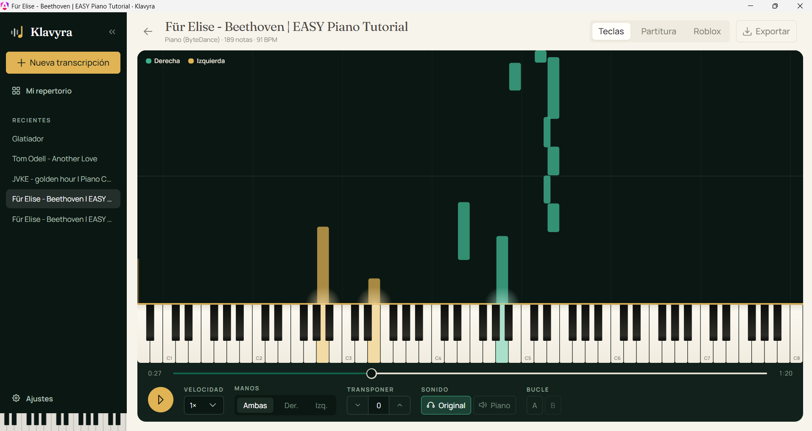
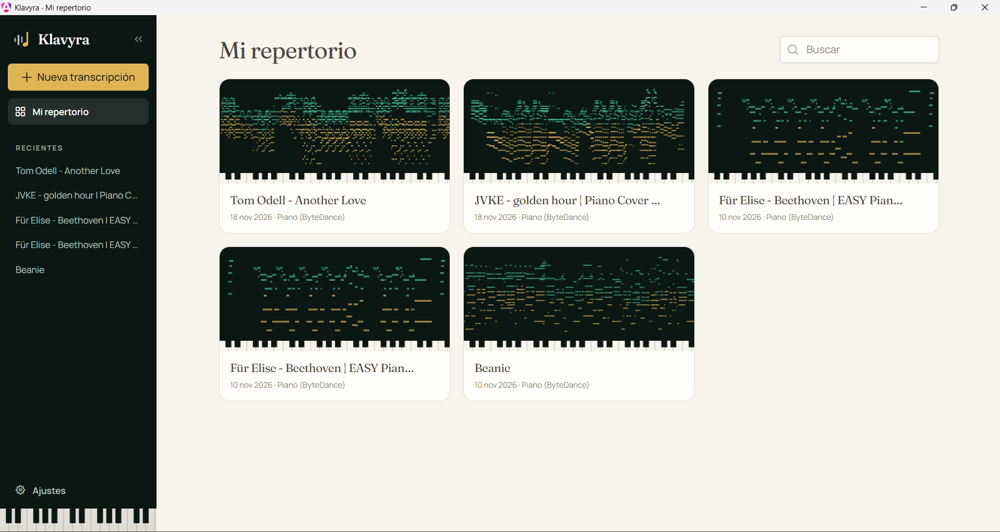

# Klavyra

Convierte cualquier canción en piano que puedas tocar: teclas cayendo, partitura y MIDI, gratis y en tu PC.

| | |
|---|---|
|  |  |
| **Empieza** subiendo un audio o pegando un enlace | **Mi repertorio**: todas tus transcripciones |
|  |  |
| **Partitura** con cursor que sigue la música | **Ajustes**: comprueba tu GPU, ffmpeg y MuseScore |

## Descargar

Descarga `Klavyra-Setup-<versión>.exe` desde [Releases](https://github.com/J-Roque/Klavyra/releases) y ejecútalo.
No pide permisos de administrador.

Necesitas Windows 10 u 11 (64 bits) y unos 4 GB libres: la primera vez descarga lo necesario para la IA.
Con una GPU NVIDIA transcribe mucho más rápido, pero también funciona sin ella.

## Funciones

- Sube un MP3, WAV o MP4, o pega un enlace.
- **Teclas cayendo** sincronizadas con el audio original, con mano derecha e izquierda en colores distintos.
- **Partitura** de dos pentagramas con un cursor que sigue la música.
- Velocidad de 0.25× a 1×, bucle A-B, transposición y piano sintetizado para practicar.
- Descargas en **MIDI**, **MusicXML** (editable en MuseScore) y **PDF** (con [MuseScore 4](https://musescore.org) instalado).
- Sin suscripciones ni límites de minutos.

¿Quieres compilarlo o contribuir? Mira [CONTRIBUTING.md](CONTRIBUTING.md).

## Licencia

© 2026 Johel Roque. Klavyra es software libre bajo la licencia [GNU AGPL-3.0](LICENSE).
Los componentes de terceros y sus licencias están en [THIRD-PARTY-NOTICES](desktop/THIRD-PARTY-NOTICES.txt).
Úsalo con música propia, de dominio público o con permiso.
