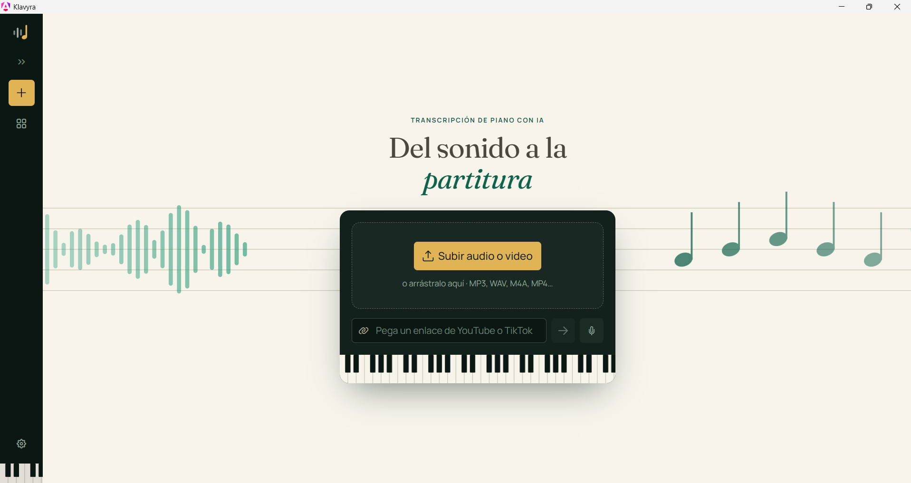
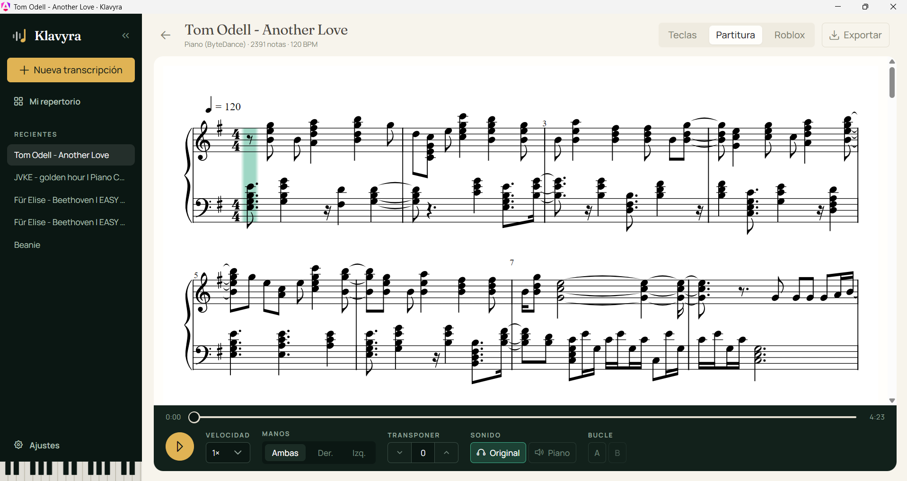
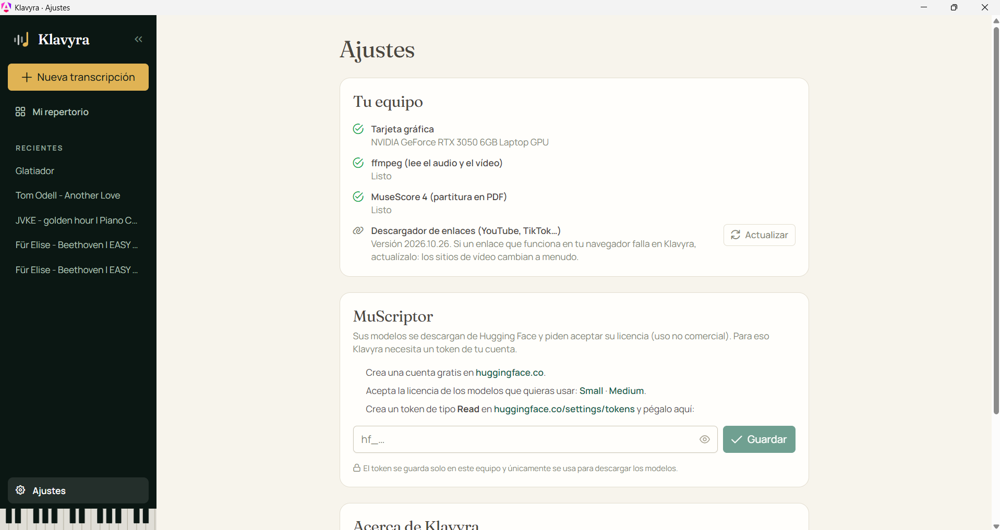
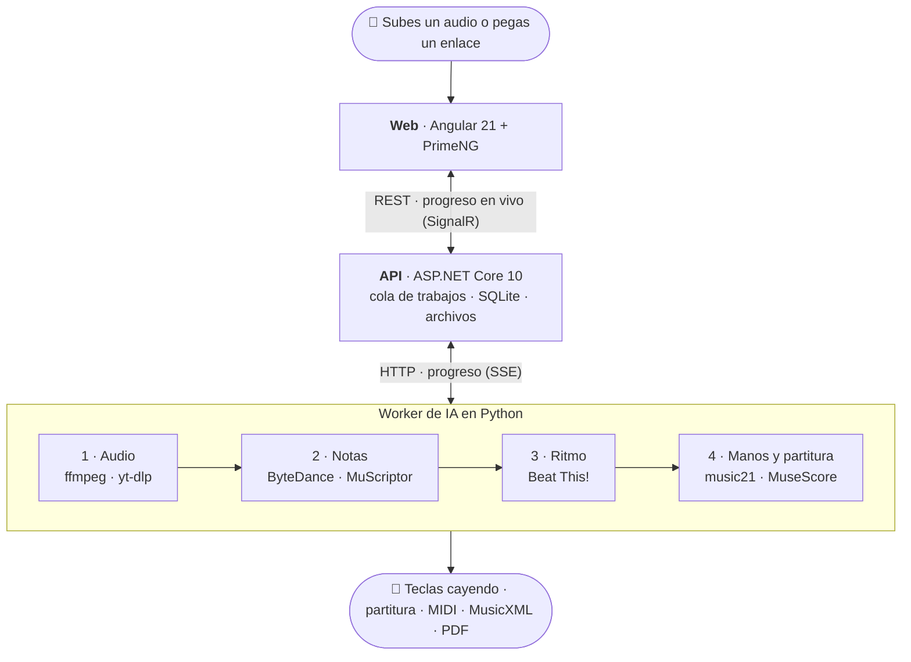

# Klavyra

### Del sonido a la partitura: convierte grabaciones de piano en teclas cayendo, partitura y MIDI, gratis y en tu PC.

[Descargar](#descargar) · [Funciones](#funciones) · [Cómo funciona](#cómo-funciona) · [Preguntas frecuentes](#preguntas-frecuentes) · [Desarrollo](CONTRIBUTING.md)

| | |
|---|---|
|  |  |
| **Empieza** subiendo un audio o pegando un enlace | **Mi repertorio**: todas tus transcripciones |
|  |  |
| **Partitura** con cursor que sigue la música | **Ajustes**: comprueba tu GPU, ffmpeg y MuseScore |

## Descargar

Descarga `Klavyra-Setup-<versión>.exe` desde [Releases](https://github.com/J-Roque/Klavyra/releases) y ejecútalo.
No pide permisos de administrador.

Necesitas Windows 10 u 11 (64 bits) y unos 4 GB libres: la primera vez descarga lo necesario para la IA.
Con una GPU NVIDIA transcribe mucho más rápido, pero también funciona sin ella.

## Funciones

- Sube un MP3, WAV o MP4, o pega un enlace. Canciones de hasta 30 minutos.
- **Teclas cayendo** sincronizadas con el audio original, con mano derecha e izquierda en colores distintos.
- **Partitura** de dos pentagramas con un cursor que sigue la música.
- Velocidad de 0.25× a 1×, bucle A-B, transposición y piano sintetizado para practicar.
- Descargas en **MIDI**, **MusicXML** (editable en MuseScore) y **PDF** (con [MuseScore 4](https://musescore.org) instalado).
- Sin suscripciones ni cuotas mensuales.

Funciona mejor con grabaciones de piano solo. Con otros instrumentos o con voz obtienes un arreglo aproximado.

## Cómo funciona

En escritorio, `Klavyra.exe` (WinForms + WebView2) abre la web y arranca la API y el worker en tu equipo.
En desarrollo, .NET Aspire 13 levanta lo mismo con un solo comando y un panel con registros y trazas.

1. **Audio.** ffmpeg normaliza el archivo; si es un enlace, yt-dlp lo descarga primero.
2. **Notas.** Un modelo de IA (ByteDance Piano Transcription, o MuScriptor) detecta cada nota con su inicio, duración, intensidad y pedal.
3. **Ritmo.** Beat This! encuentra el pulso y los compases para que la partitura quede alineada.
4. **Manos y notación.** Las notas se reparten entre mano derecha e izquierda y music21 escribe la partitura.
5. **Reproductor.** La web dibuja las teclas cayendo y la partitura (OpenSheetMusicDisplay) sincronizadas con el audio original.

Algunas decisiones técnicas:

- **Todo corre en local.** La API y el worker solo escuchan en `127.0.0.1`; el lanzador elige puertos libres y cierra
  los procesos hijos con un *Job Object* de Windows aunque la ventana se cierre de golpe.
- **Instalador pequeño (~110 MB).** PyTorch (~2.5 GB) no va dentro: el lanzador crea el entorno con `uv` la primera
  vez y muestra el avance de la descarga.
- **Progreso en vivo.** El worker emite eventos por SSE, la API los guarda y los reenvía por SignalR; al reconectar,
  la web vuelve a pedir el estado para no quedarse con datos viejos.
- **Datos que sobreviven a las actualizaciones.** Migraciones de EF Core (las bases antiguas se adoptan con copia de
  seguridad) y SQLite en modo WAL para que la API y el worker no se bloqueen.

## Preguntas frecuentes

<b>¿Funciona sin tarjeta gráfica NVIDIA?</b>

Sí. Sin GPU la IA corre en el procesador: el resultado es el mismo, pero tarda bastante más. En Ajustes puedes ver si
Klavyra detectó tu tarjeta.

<b>¿Qué tan precisa es la transcripción?</b>

Con grabaciones de piano solo, muy buena: es para lo que están entrenados los modelos. Con bandas, voz u otros
instrumentos obtienes un arreglo aproximado que conviene revisar. Puedes corregirla abriendo el MusicXML en MuseScore.

<b>¿Por qué el límite de 30 minutos?</b>

Un audio más largo tarda demasiado en transcribirse y produce una partitura difícil de leer. Para piezas largas,
córtalas por movimientos o secciones.

<b>¿Dónde se guardan mis transcripciones?</b>

En `%LOCALAPPDATA%\Klavyra`, junto con los modelos y los registros. Al desinstalar, Klavyra pregunta si quieres
borrarlos; por defecto se conservan.

<b>Un enlace de YouTube dejó de funcionar. ¿Qué hago?</b>

Los sitios de video cambian a menudo. Ve a Ajustes y pulsa <b>Actualizar</b> en "Descargador de enlaces".

<b>¿Puedo vender o publicar las partituras que obtengo?</b>

Solo si tienes derechos sobre la música: tus propias composiciones u obras de dominio público (Bach, Beethoven,
Chopin…). Venderla o publicarla si la canción tiene derechos de autor, no; el uso personal depende de las leyes de tu país.

## Aviso legal

Klavyra es una herramienta de estudio. Descargar de YouTube u otras plataformas puede ir contra sus términos de uso,
y las transcripciones de obras con derechos de autor no se pueden vender ni publicar sin permiso. Úsalo con música
propia, de dominio público o con permiso.

## Contribuir

¿Quieres compilarlo, ejecutar las pruebas o crear el instalador? Mira [CONTRIBUTING.md](CONTRIBUTING.md).

## Licencia

© 2026 Johel Roque. Klavyra es software libre bajo la licencia [GNU AGPL-3.0](LICENSE).
Los componentes de terceros conservan sus propias licencias: ver [THIRD-PARTY-NOTICES](desktop/THIRD-PARTY-NOTICES.txt).
Los pesos de MuScriptor son de uso no comercial (CC BY-NC 4.0).
